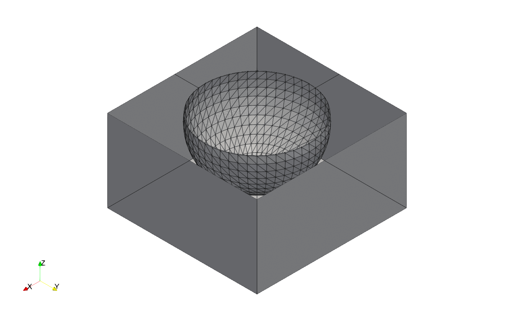
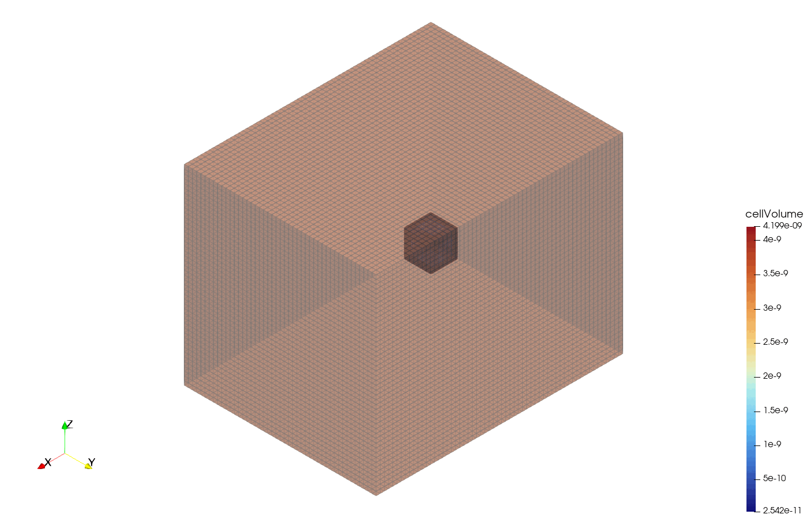
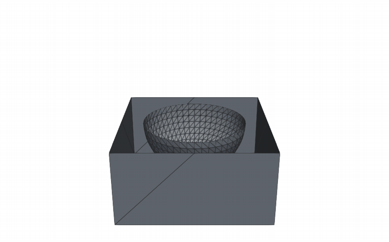

# dsh-mesh-toolkit

[](https://github.com/AstDen/dsh-mesh-toolkit/actions/workflows/ci.yml)

> **1.0.0** · packages: mesh-build 1.0.0 · mesh-stl 1.0.0 · sim-core 1.0.0
> host-only plugins distilled from the `Mesh_3D_pore_scale` project. Build a
> watertight STL, turn it into a checked OpenFOAM mesh, then package it as an
> OpenFOAM case plus an ANSYS/Fluent `.msh`. Twelve tools, 40 searchable knowledge
> cards in the merged catalogue, no build step. Meshing routes adapt to OpenFOAM.com **or** OpenFOAM.org.
> Every checked case carries a `handoff.json` (schema `mesh-handoff/1`) for a solver-side workbench,
> and the optional `meshToolkit` service (`apiVersion: 1`) lets one call mesh, gate and deliver.

| Package | Jobs | Tools |
|---|---|---|
| [`sim-core/`](sim-core/) | config layering, `sim-project.json`, path resolver, checkMesh parser, JS quality gate, passports, shared cards | library, no tools |
| [`mesh-stl/`](mesh-stl/) | STL families and portable primitives, in-plugin JS contract QA (python `stl_qa.py` as parity reference), cleanup, passport row | `stl_hints` · `stl_generate` · `stl_check` |
| [`mesh-build/`](mesh-build/) | snappyHexMesh / cfMesh / gmsh route D on any OpenFOAM build, JS quality gate, mesh passport, OF+Fluent delivery, capability probe, patch roles, feedback-driven revisions, y+ layers, surface fidelity | `mesh_hints` · `mesh_build` · `mesh_check` · `mesh_deliver` · `mesh_capabilities` · `mesh_patch_types` · `mesh_revise` · `mesh_first_layer` · `mesh_surface_check` |

Thin wrappers over the project's real generators and OpenFOAM binaries. No invented
metrics: every number comes from a real run, full logs stay on disk, the tool returns
a compact JSON summary. Plugins talk to each other through Cordis services
(`simHints`, `simGeometry`, `simMesh`), not through each other's files.

## Status

Validated on **OpenFOAM.com v2512**, **v2606** and **OpenFOAM.org v14**, **ParaView 6.2.1**,
**gmsh 4.15.2**, **CadQuery 2.8.0**, Node 24.

**12 tools · 40 cards in the merged `mesh_hints` catalogue · 22 in `stl_hints` · 2 skills · 3 services · smoke and live tested

## 60 seconds

```bash
git clone https://github.com/AstDen/dsh-mesh-toolkit && cd dsh-mesh-toolkit
node scripts/doctor.mjs   # can this machine run it? one PASS/WARN/FAIL row per area
node scripts/demo.mjs     # geometry -> STL QA -> snappy mesh -> gate -> delivery, about 30 s
```

`doctor` reports what the toolkit will and will not be able to do here (Node, the two bundles,
knowledge cards, OpenFOAM flavour and tools, python, ParaView); `demo` runs the whole pipeline on a
10 mm cube with a 3.5 mm-radius sphere cavity and leaves a runnable case behind:

```
1/5 geometry  box 10 mm with a 3.5 mm-radius sphere removed -> .cache/demo/geo/pore-demo.stl
2/5 stl QA    PASS · watertight true · 2220 triangles · 2 closed shells
3/5 mesh      background cells 59,46,46 · gate PASS (project) · 13.8 s
4/5 gate      cells 148 288 · maxNonOrtho 26.4 deg · maxSkewness 0.367 · PASS
5/5 delivery  openfoam_demo/demo.foam · openfoam_demo.tar.gz · ansys_demo/ · delivery_demo.{json,md}
DEMO OK in 26.1s
```

| | |
|---|---|
|  |  |
| the STL: a 10 mm box with a 3.5 mm sphere cavity, clipped so the interior shows | the built case, semi-transparent: hex cells refined on the cavity, coloured by cell volume |

The same cavity, rotating — the clipped STL again
([`scripts/make-media.py`](scripts/make-media.py) regenerates it with `pvpython`,
[`scripts/make-media.sh`](scripts/make-media.sh) assembles the GIF):



All images are ParaView renders of the demo artefacts produced on this machine, not mock-ups.

## Install

Requirements: Node ≥ 20, DSH `>= 0.2.2-rc.1 < 0.3.0`, an OpenFOAM installation (com or org).
No project checkout is required: generator scripts ship in `mesh-stl/generators/` and STL QA
runs in-process on JS. Python is needed only for the python families
(`trimesh`, `numpy`; `cadquery`/`scipy`/`skimage` for specific ones) and for the parity
test (`tools/qa/stl_qa.py` is the reference, not a dependency).

### One package from git (recommended)

The repository root is a single installable package: the three source trees ship inside it, so
the relative imports between them keep working and there is nothing to place side by side.

```bash
dsh plugin --profile web add "git+https://github.com/AstDen/dsh-mesh-toolkit.git#<commit>"
```

`<commit>` is a full 40-hex commit from [`market/index.json`](market/index.json) (the same pin the
plugin market uses). Start DSH, then `plugin_manager list_plugins` shows `mesh-toolkit` with both
plugin rows enabled (`mesh-toolkit/build`, `mesh-toolkit/stl`).

### From a plugin market

DSH ships no index source, so add this repository's index once:

1. enable the experimental **Custom plugin indexes** bundle;
2. **Plugins → Discover → Add index source** →
   `https://raw.githubusercontent.com/AstDen/dsh-mesh-toolkit/master/market/index.json`;
3. install **Mesh toolkit — pore-scale meshing for OpenFOAM**.

The index is a format-1 document (`market/index.json`) validated by the official
`@deepseek-ai/dsh-plugin-market-index` parser, and it pins the same git commit, so both channels
install identical code.

### Side by side (development)

Point the installer at the two bundle directories in a checkout:

```json
{ "action": "install_bundle", "target": "/path/to/dsh-mesh-toolkit/mesh-stl" }
{ "action": "install_bundle", "target": "/path/to/dsh-mesh-toolkit/mesh-build" }
```

`sim-core` is a library, not a bundle. This mode adds a `link:` dependency to the profile and
enables each bundle through its own `cordis.patch.yml`; edit the sources in place and reload with
disable → enable — a repeated `enabled: true` reports `changed: false` and does not re-import.

Disable with `set_plugin` `enabled: false`; remove with `remove_bundle` (bundle package name).

First run: [`docs/QUICKSTART.md`](docs/QUICKSTART.md) — five calls from nothing to a gated, delivered mesh.
Error strings: [`docs/TROUBLESHOOTING.md`](docs/TROUBLESHOOTING.md).

First run without a case — `doctor` checks the environment, `demo` meshes a cube with a spherical
pore and delivers it (~26 s, needs OpenFOAM):

```bash
node scripts/doctor.mjs
node scripts/demo.mjs
```

Tests (no DSH host, no OpenFOAM for the unit tier):

```bash
npm test                              # 34 unit checks: domain, caps, advice/revise, surfacecheck
node scripts/contract-test.mjs        # 37 contract checks; --no-mesh skips the OpenFOAM tier
node mesh-stl/scripts/smoke.mjs
node mesh-build/scripts/smoke.mjs
```

## OpenFOAM versions

Installations live in `sim-project.json → foam.installations`; each tool accepts
`openfoam: "<id>"` or an absolute `etc/bashrc`, defaulting to `foam.default`.

| Capability | OpenFOAM.com (v2412…v2606) | OpenFOAM.org (v14) |
|---|---|---|
| cfMesh (`cartesianMesh`, `pMesh`, …) | yes | **no** |
| `surfaceFeatureExtract` | yes | stub (rc=0, writes nothing) |
| `surfaceFeatures` + `surfaceFeaturesDict` | no | yes |
| `reconstructParMesh -mergeTol` | yes | no |
| `locationsInMesh` (multi-region snappy) | yes | **no** (single `locationInMesh`) |
| `foamRun` / `foamMultiRun` | no | yes |

The snappy route picks the feature dictionary and the merge flag automatically; `cfmesh`
preflight refuses on org with an actionable message. Same STL and settings gave
`maxNonOrtho` 9.7073° on com2512/com2606 and 25.2146° on org14 with identical 2584 cells —
compare metrics between builds, not only between runs. Matrix: `tools/qa/of_matrix.sh`.

## Configuration

A project is described by **`sim-project.json`** in its root (schema:
`sim-core/schemas/sim-project.schema.json`): `units`, `caseRoots`, `scratch`, `foam`,
`fluent`, `gate {engine, profile, profiles, minVol, script}`,
`geometry {registry, workRoot, scriptRoots}`, `cores`, `physics`. The resolver walks up
to 12 levels from the session cwd; without a profile both plugins still work from the
cwd, and `primitive` needs nothing at all.

Precedence: `sim-project.json` → `config` in `cordis.patch.yml` →
`~/.config/{mesh-stl,mesh-build}/config.json` (override with `MESH_STL_CONFIG` /
`MESH_BUILD_CONFIG`) → `MESH_STL_*` / `MESH_BUILD_*` environment variables.

| Setting | Default | Meaning |
|---|---|---|
| `projectRoot` | auto-detect | walk up from the session cwd for `sim-project.json`; without one the tools run on defaults (`project: "defaults"`) |
| `workRoot` | `stl/generated` / `.cache/mesh-build` | project-relative output root |
| `registry` | `stl/registry.csv` | STL passport |
| `caseRoot` | `cases` | mesh-build case lookup root (cwd-relative; `caseRoots: ["./cases"]`) |
| `foam.installations` / `foam.default` | profile | named OpenFOAM builds (`{id: {bashrc}}`); every tool takes `openfoam: "<id>|<bashrc>"` |
| `openfoamBashrc` | auto | explicit `etc/bashrc`; otherwise `foam.default`, `openfoamRoots`, then `/usr/lib/openfoam`, `/opt/openfoam`, `~/openfoam` (newest wins) |
| `openfoamRoots` | `[]` | extra trees, `MESH_*_OPENFOAM_ROOTS` (colon-separated) |
| `python` | `<project>/.venv/bin/python` | interpreter for generators and gmsh |

No machine-specific paths ship in the repository — install targets, project roots and
OpenFOAM locations are placeholders. When the project cannot be found, a tool returns
`configured: false` with the exact setting to provide instead of throwing.

## What you get

**sim-core** — one implementation of everything both plugins share: layered config,
project profile, path resolver with `resolvedFrom`, process runner (`source bashrc` →
`set -u`), `checkMesh -meshQuality` parser, quality gate, artifact passports, knowledge
store. `meshQualityDict` is written with all 13 keys; the verdict comes from the log
text, because `checkMesh` exits 0 even on `Failed N mesh checks`. `foam.js` resolves a
named installation and `withFoam()` binds one to a single tool call.

**mesh-stl** — families `fcc-cell`, `channel-spheres`, `double-layer-burner`,
`packing`, `cad-porous`, plus portable `primitive` (box / sphere / cylinder written in
plain JS, no Python, no project data). `geometry.scriptRoots` keeps generators outside
the project; presets resolve from `@package/...`. `stl_generate` runs the real
generator and QA-verifies every output; `stl_check` cleans and registers.

**mesh-build** — routes `snappy`, `cfmesh`, `gmsh`, `check`; `mesh_build` with
`scaffold: true` writes a runnable snappy case plus `case-manifest.json`, otherwise
builds an existing case; after the gate it writes `mesh-passport.json` (route, cells,
regions, thresholds, sha256/size/mtime of the polyMesh). `mesh_check` reports
`PASS/FAIL/ERROR`, threshold violations and passport freshness, and records the
verdict in `mesh-passport.json`. `mesh_deliver` packages a PASSed case: an OpenFOAM
case with a real `constant/` and `.foam` marker plus `.tar.gz`, an ANSYS/Fluent `.msh`
with `read_mesh.jou` plus `.zip`, and `delivery_<name>.{json,md}`; a stale or missing
passport blocks the run (`force: true` overrides, the delivery gate still runs).

**Skills** — `mesh-stl` and `mesh-build` load on demand and carry the order of work,
hard rules and extension instructions. **Cards** — 32 per catalog: own cards plus the
neighbour's, with shared snappy/plugin cards deduplicated.

## Extending

Rule of thumb: **data first, code second**. Generators, cards, routes and thresholds
are JSON; new tools are plain `defineTool` registrations.

[docs/extending.md](docs/extending.md) — schemas, placeholders, step conditions,
profiles, scaffold options and the reload rule.

## Benchmark

[benchmark/TESTS.md](benchmark/TESTS.md) is the universal regression suite for both
plugins: 10 groups (A–V, L) with exact parameters, analytic references, gate acceptance
and time budgets —

- **A** primitives: cube, sphere, cylinder, box override, STL accuracy;
- **B** channel with 6/28 spheres: snappy, cfMesh, parallel run;
- **C** external flow: sphere refinement study, cube, cylinder, crossing-cylinder block;
- **D** dispersed/multiphase geometry: suspension packing, interface refinement, a
  documented gap for a stratified channel;
- **E** porous media: FCC cell (baseline 27 424 cells / 41.34°), mono- and
  polydisperse packings;
- **F** hints: query → expected card ids, including the advisory/refusal behaviour;
- **G/H** tool contracts and negative tests; **V** version comparison
  com2512 / com2606 / org14; **L** delivery packaging.

A run writes `benchmark/run-<ts>/{calls.csv,metrics.json,REPORT.md}` and is scored
geometry 20 · mesh 25 · robustness 20 · ergonomics 20 · performance 15.

[benchmark/PROMPT.md](benchmark/PROMPT.md) is the shorter two-task variant (primitives
and packings) for a quick evaluation pass.

## Comparison

Measured against [`@yakovlev-i-a/dsh-openfoam-workbench`](https://github.com/yakovlev-i-a/dsh-openfoam-workbench)
0.9.22 on 2026-11-26 — both packages installed in the same DSH host, the same STL and the same
`checkMesh`. The two are complements: that package carries the solver-facing half (case setup, BCs, runs),
this one the geometry-and-mesh half, and the seam between them is
[`docs/WORKBENCH-CONTRACT.md`](docs/WORKBENCH-CONTRACT.md).

| | dsh-mesh-toolkit | dsh-openfoam-workbench 0.9.22 |
|---|---|---|
| licence | MIT | Apache-2.0 |
| tools | 12 | 64 |
| knowledge cards | 40 (from 20+ experiments) | — |
| pore-scale generator families | 9 (FCC cell, packings, blob foam, CAD porous, …) | — |
| primitives (box/sphere/cylinder/cone/pipe/`parts[]`) | ✅ | ✅ |
| STL QA without Python | ✅ in-process JS (+ python reference, 15/15 parity) | ✅ in-process |
| routes | snappy, cfMesh (cartesianMesh/pMesh/tetMesh), gmsh OCC | snappy |
| threshold gate (`checkMesh -meshQuality`, verdict from log text) | ✅ PASS/FAIL per region | ✅ |
| mesh passport + stale-verdict detection | ✅ | — |
| one-command delivery (OpenFOAM case + `.tar.gz` + Fluent `.msh` + round-trip) | ✅ | — |
| `handoff.json` + revision loop (`mesh_feedback` → `mesh_revise`) | ✅ | consumes the seam (Part B) |
| OpenFOAM-free surface fidelity check (bbox/Hausdorff vs STL) | ✅ | ✅ (needs a triangulator) |
| portable mode (no `sim-project.json`) | ✅ (acceptance: `docs/ACCEPTANCE.md`) | ✅ |

One measured difference in the seam: the workbench's `parseBoundaryPatches` truncates hyphenated patch
names (`lib/of-engine.js:972`, `/(\w+)\s*\{([^}]*)\}/g` → `a1-cube` becomes `cube`), which we pin with the
`M3c` contract check; a scaffolded case then fails on `Cannot find patchField entry for a1-cube`. Reported
upstream in issue #1; until it is fixed, deliveries with hyphenated patch names need the patch renamed or
the case scaffolded by hand.

## Limits

- No solvers and no Fluent run: the delivery builds the `.msh` and the journal, it does
  not open Fluent. Meshing itself stops at a passing gate.
- The gate is JS (`sim-core/lib/gate.js`); `tools/qa/mesh_gate.sh` is kept only as a
  parity reference and `gate.engine: "script"` escape hatch.
- `mesh-passport.json` records what the gate saw; `mesh_check` compares size+mtime,
  then sha256, and reports `stale` instead of silently trusting an old verdict.
- Patch semantics are not assigned: CAD/STL surfaces become `wall`, so inlet/outlet
  types still need a manual `boundary` edit before a solver run.
- The gmsh route expects a ready OCC script and `.msh`; no gmsh scaffold is generated.
- `minVol` and `minTetQuality` are absolute volumes; pass `minVol` per mesh and record
  it in the run report.
- cfMesh layers over tetrahedra and `polyDualMesh` for CHT were rejected — see the
  `rejected-routes` and `cfmesh-layers-tetra` cards.

## Layout

```
README.md                 this file
benchmark/TESTS.md         universal regression suite (A–V, L)
benchmark/PROMPT.md       shorter two-task evaluation protocol
docs/QUICKSTART.md        five calls from nothing to a gated, delivered mesh
docs/TROUBLESHOOTING.md   literal error strings → cause → fix
docs/VERSION-POLICY.md    what a version means, DSH compatibility rules
docs/ACCEPTANCE.md        clean-user acceptance run: commands, numbers, defects it found
docs/GALLERY.md           what the example geometries look like
CONTRIBUTING.md           the checks to run, what an issue needs
docs/extending.md         data schemas, routes, thresholds, reload rule
docs/PORTABLE.md          working without sim-project.json
docs/WORKBENCH-CONTRACT.md  mesh-toolkit ↔ openfoam-workbench contract (schemas, roles, loop)
docs/PLAN-workbench-integration.md  analysis of the workbench, adoption methodology, work items
sim-core/                 shared library (not installed as a bundle)
  lib/config.js           layered config + sim-project.json discovery
  lib/project.js          profile normalisation, built-in gate profiles
  lib/paths.js            absolute → cwd → caseRoots → projectRoot resolver
  lib/process.js          source bashrc → set -u, runPython
  lib/hints.js            card store, simHints service
  lib/checkmesh.js        metrics, violations, verdict from log text
  lib/gate.js             full meshQualityDict, .mesh-gate overlay, PASS/FAIL/ERROR
  lib/passport.js         mesh-passport.json, case-manifest.json, freshness
  schemas/*.json          sim-project, mesh-passport, case-manifest, stl-passport
mesh-stl/                 STL plugin
  index.js                3 tools + skill + simGeometry service
  lib/                    facade config, hints, generators, primitives, registry
  data/generators.json    families and presets (incl. primitive)
  data/primitives/*.json  cube / sphere / cylinder presets
  data/hints/*.json       20 cards
  scripts/smoke.mjs
mesh-build/               meshing plugin
  index.js                4 tools + skill + simMesh service
  lib/                    facade config, routes, scaffold, gate adapter, delivery, patches
  data/engine.json        routes and quality profiles
  data/hints/*.json       22 cards
  scripts/smoke.mjs
```

## Provenance and license

Distilled from a pore-scale meshing project (OpenFOAM + ParaView); its thresholds
follow the project's ADRs and the `project` gate profile. No third-party code is
vendored. MIT — see [LICENSE](LICENSE).
