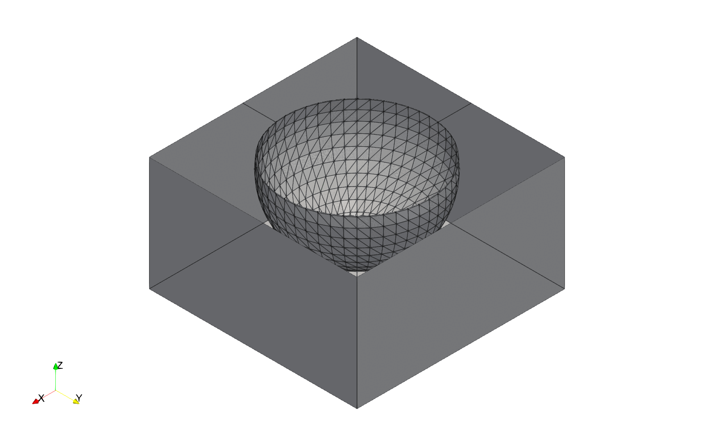
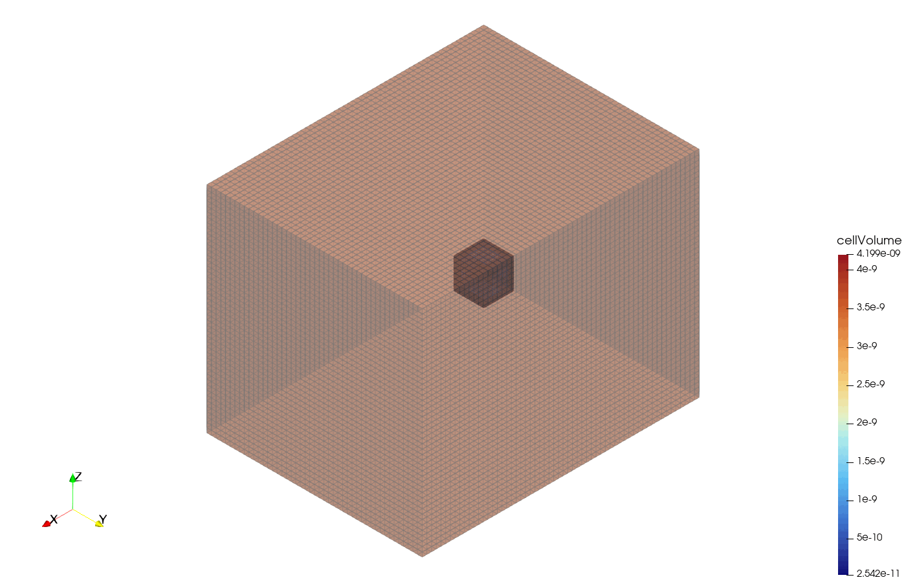
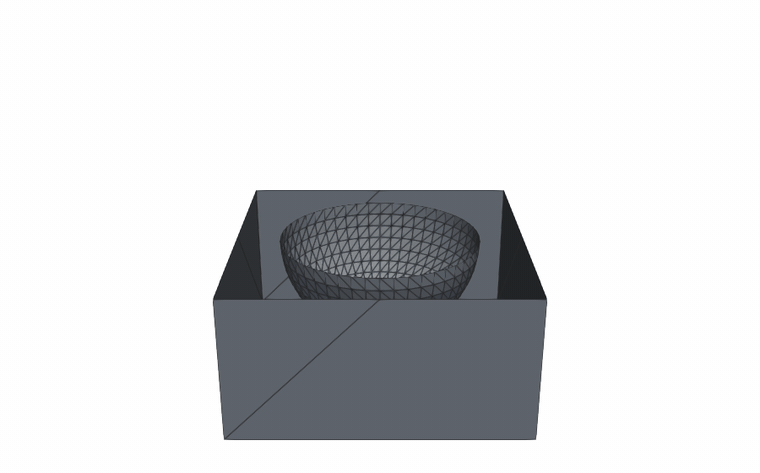

# Gallery

Every image on this page is a ParaView render of an artefact this toolkit produced on the machine described
in `docs/ACCEPTANCE.md` — no mock-ups, no CAD renders. Commands are given so any of them can be reproduced.

## The 60-second demo

`node scripts/demo.mjs` (see [`ACCEPTANCE.md`](ACCEPTANCE.md)) — a 10 mm box with a 3.5 mm-radius sphere
removed, meshed with snappyHexMesh and delivered:

| | |
|---|---|
|  |  |
| **geometry** — `scripts/make-media.py`, clipped STL, 2 220 triangles, 2 closed shells | **mesh** — the same case clipped, `--opacity 0.35`, coloured by `cellVolume` |



*Camera sweep of the clipped geometry (`scripts/make-media.sh`, 16 frames, ffmpeg palette).*

## Where the other numbers come from

| Case | What it shows | Reference |
|---|---|---|
| FCC cell, d = 5 mm, r = 0.49 | pore-scale baseline: 27 424 cells, gate PASS | `benchmark/TESTS.md` §E, `mesh-stl` family `fcc-cell` |
| channel with 6 / 28 spheres | snappy vs cfMesh on the same STL | §B |
| external flow, sphere refinement study | refinement levels → cell count → gate verdict | §C |
| mono- and polydisperse packings | `minVol ≈ h_min³/6` in practice | §E |
| CHT block (fluid + solid regions) | multi-region snappy, `splitMeshRegions`, per-region gate | `mesh-build` skill, `docs/extending.md` |

## Rendering your own

```bash
# the animation: STL in, docs/img/demo.gif out
scripts/make-media.sh path/to/geometry.stl 16

# a single clipped frame with a colourbar (project helper, any case)
tools/pv/pv_view.sh --input path/to/case --cut 0.45 --res 1600x1000 --out docs/img/case.png
```

`make-media.sh` sets the headless ParaView environment (`EGL_PLATFORM=surfaceless`,
`LIBGL_ALWAYS_SOFTWARE=1`, `--force-offscreen-rendering`), needs `pvpython` 6.x (`PVPYTHON=/path/…` overrides
the search) and `ffmpeg`. `tools/pv/pv_view.sh` belongs to the parent project and also knows how to project
`cellVolume` and edges; its `--cut-mode slice` path crashes on the demo case
(`OverflowError: numerical result out of range`), so the clip mode is the one used above.
